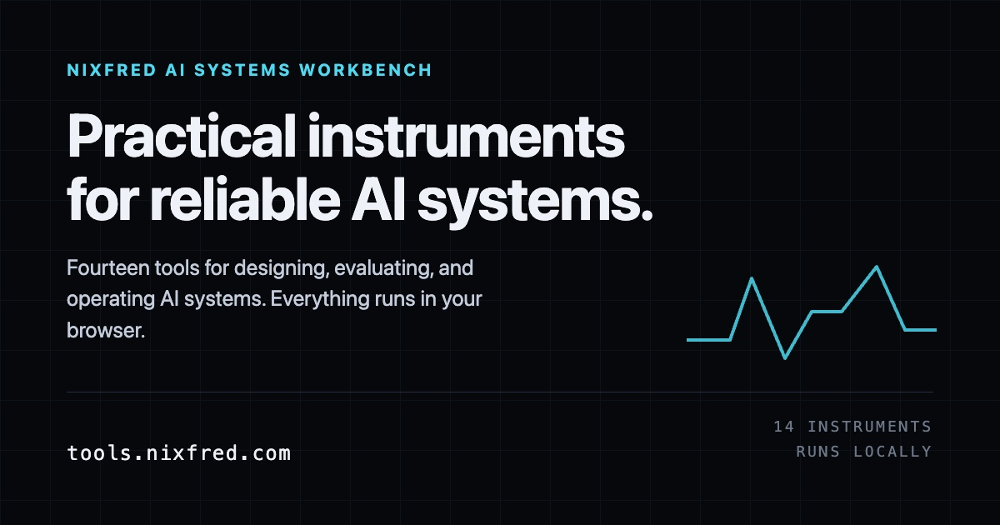
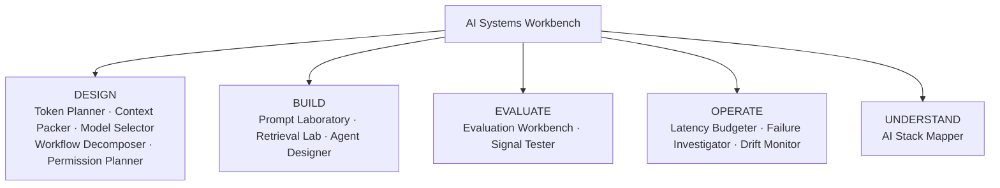
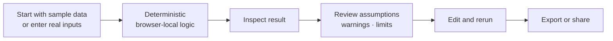
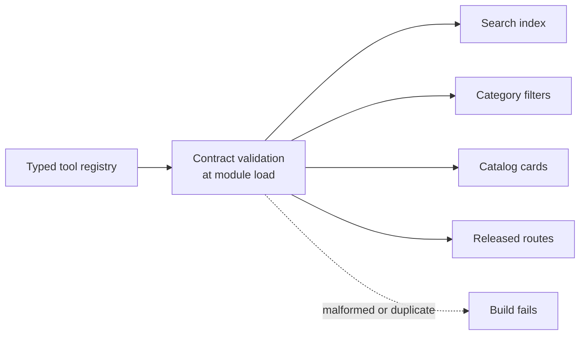
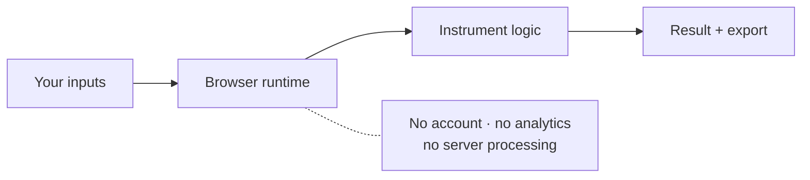

<div align="center">



# Nixfred AI Systems Workbench

### Small, sharp instruments for AI system work that is easy to get wrong.

Fourteen interactive tools turn real inputs into inspectable, editable, exportable results. Everything runs locally in the browser with sample data and no account.

[](https://astro.build)
[](#fourteen-instruments-five-disciplines)
[](#local-by-default)

**[Open the workbench →](https://tools.nixfred.com)**

</div>

## Fourteen instruments, five disciplines



The workbench is not a chat product or a news feed. Each instrument isolates one engineering decision, makes its assumptions visible, and produces an artifact that can be reviewed or exported.

## One interaction contract



The shared UI kit supplies consistent fields, help notes, warning states, assumption lists, result panels, error boundaries, privacy notices, and export controls. A tool still owns its own domain logic and acceptance tests.

## Registry-driven discovery



Tool names, categories, status, routes, tags, sensitivity, sample support, export support, and PRD identity live in one registry. Adding a conforming entry automatically places it in search, filters, counts, and the catalog without editing landing-page markup.

## Local by default



What you type stays on the device. Core tools require no API key. If a future instrument needs an external transfer, its own page must disclose exactly what leaves before the user acts.

## Instrument catalog

| Discipline | Instruments |
|---|---|
| Design | Token & Cost Planner, Context Packer, Model Selector, Workflow Decomposer, Permission Planner |
| Build | Prompt Laboratory, Retrieval Lab, Agent Designer |
| Evaluate | Evaluation Workbench, Signal Tester |
| Operate | Latency Budgeter, Failure Investigator, Drift Monitor |
| Understand | AI Stack Mapper |

Every instrument has an individual PRD, implementation module, page, and focused logic test under `tests/tool-*.mjs`.

## Run locally

```bash
git clone https://github.com/nixfred/tools.nixfred.com.git
cd tools.nixfred.com
bun install
bun run dev
```

Run the complete quality suite:

```bash
bun run test
```

The suite builds the site and checks links, safety language, copy rules, canonical URLs, registry integrity, contrast, cross-tool factual consistency, and all fourteen tool implementations.

## Architecture

- Astro static output with no application backend
- Type-safe central registry and route contract
- Shared accessible instrument UI kit
- Versioned browser persistence and share-state utilities
- Logic separated into `src/lib/tools/` for direct testing
- GitHub Actions deployment to Cloudflare Pages

Product requirements and build-control decisions are retained in [`tools-nixfred-prds/`](tools-nixfred-prds/) and [`docs/decisions/`](docs/decisions/).
